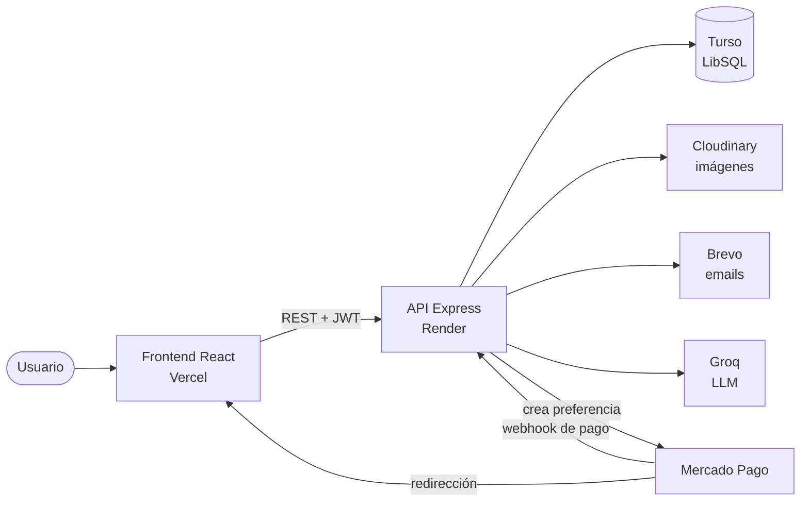

# 📱 AirMobile — E-commerce de dispositivos Apple

> Tienda online fullstack de iPhones, iPads, Apple Watch, AirPods y accesorios, con pagos por Mercado Pago, facturación en PDF, panel de administración y un asistente virtual con IA conectado al catálogo real.

**🔗 Demo en vivo:** [https://airmobile.vercel.app/](https://airmobile.vercel.app/)

> ⚠️ **Sitio de demostración.** Es un proyecto de portafolio: los productos son de ejemplo y los pagos usan el entorno de prueba de Mercado Pago, así que no se realizan compras reales.
> El backend corre en un plan gratuito que se suspende por inactividad: **la primera carga puede tardar alrededor de un minuto**.

<!-- Agregá capturas o un GIF del sitio:  -->

---

## Tabla de contenidos

- [Funcionalidades](#funcionalidades)
- [Stack tecnológico](#stack-tecnológico)
- [Arquitectura](#arquitectura)
- [Asistente virtual con IA](#asistente-virtual-con-ia)
- [Pagos con Mercado Pago](#pagos-con-mercado-pago)
- [Autenticación](#autenticación)
- [Cómo probar la demo](#cómo-probar-la-demo)
- [Instalación local](#instalación-local)
- [Variables de entorno](#variables-de-entorno)
- [Despliegue](#despliegue)
- [API — Endpoints](#api--endpoints)
- [Estructura del proyecto](#estructura-del-proyecto)
- [Equipo](#equipo)

---

## Funcionalidades

### Para usuarios
- **Registro y login** con verificación de cuenta por código enviado al email.
- **Sesión segura** con access token de 15 minutos y refresh token de 7 días, con renovación automática.
- **Recuperación de contraseña** mediante código por correo.
- **Catálogo** con filtros por categoría, condición, precio, capacidad y batería, más búsqueda por texto.
- **Detalle de producto** con galería de imágenes, selección de capacidad y productos relacionados.
- **Carrito de compras** y **lista de deseados** persistentes.
- **Pago con Mercado Pago** (Checkout Pro), con regreso automático a la tienda.
- **Email de confirmación** al aprobarse el pago.
- **Historial de facturas** con descarga en PDF.
- **Asistente virtual con IA** que responde consultas sobre productos, precios y stock reales.

### Para administradores
- **Gestión de productos**: alta, baja lógica, modificación y carga de imágenes.
- **Carga masiva** de productos desde CSV o Excel.
- **Gestión de facturas** con cambio de estado.
- **Gestión de staff**: registrar, editar, dar de baja, restaurar y blanquear contraseñas de administradores.

---

## Stack tecnológico

| Capa | Tecnologías |
|---|---|
| **Frontend** | React 19, Vite, React Router 7, React Hook Form, Bootstrap 5, react-markdown |
| **Backend** | Node.js, Express 5, Joi (validación), JWT + bcryptjs, Multer, PDFKit, ExcelJS |
| **Base de datos** | Turso (LibSQL / SQLite en la nube) |
| **Integraciones** | Mercado Pago (Checkout Pro + webhooks), Cloudinary (imágenes), Brevo (emails), Groq (IA) |
| **Despliegue** | Vercel (frontend), Render (backend), Turso (base de datos) |

---

## Arquitectura



- El **frontend** es una SPA que consume la API REST. Todas las URLs se configuran por variables de entorno (`VITE_API_URL`).
- El **backend** centraliza la lógica de negocio y es el único que conoce las claves secretas (Mercado Pago, Brevo, Groq, Cloudinary).
- **CORS** restringido a los orígenes definidos en `FRONTEND_URL`.

---

## Asistente virtual con IA

El chat de la tienda usa un modelo de lenguaje de **Groq** con **tool calling**: el modelo no inventa productos, sino que decide cuándo consultar la base de datos y responde con los datos reales.

```
Usuario: "¿tenés iPhone 13?"
  → El modelo pide ejecutar  buscar_producto({ busqueda: "iPhone 13", categoria: "celulares" })
  → El backend consulta Turso y le devuelve los productos
  → El modelo responde: "**iPhone 13** - $650 · [Ver detalles](/producto/4)"
```

- **Dos herramientas:** `consultar_catalogo` (consultas generales) y `buscar_producto` (modelo, categoría, presupuesto o perfil). Si un modelo no existe, ofrece alternativas de la misma categoría.
- **Memoria por sesión:** recuerda la conversación de cada usuario e invitado.
- **Protecciones:** límite de mensajes por minuto, tope de llamadas al modelo por consulta, validación de los argumentos que genera la IA y respuestas controladas ante errores o cuota agotada.
- **Código:** `backend/src/utils/botIA.js` (lógica del agente) y `chatConIA` en `backend/src/controllers/controllerChatBot.js` (endpoint `POST /api/bot/chat`).

> **Evolución:** el asistente se prototipó primero con **n8n + Ollama** (modelo `qwen3:4b` local), incluyendo un bot que respondía emails de clientes. Para producción se integró directamente al backend con Groq, con un servicio menos que mantener y sin depender de un modelo local. Los prompts originales están en `system_prompt.txt`, `tool_catalogo.txt`, `tool_busqueda.txt` y `system_promt_email_bot.txt`.

---

## Pagos con Mercado Pago

1. El usuario confirma el carrito y el backend crea una **preferencia de Checkout Pro** con los ítems y el precio según la capacidad elegida.
2. El usuario paga en el portal de Mercado Pago y vuelve a la tienda (`/pago-exitoso`, `/pago-fallido` o `/pago-pendiente`).
3. Mercado Pago notifica al **webhook** del backend, que consulta el pago, **genera la factura**, vacía el carrito y envía el email de confirmación.

**Idempotencia:** antes de crear la factura se busca por `mp_payment_id` (que además es `UNIQUE`). Si Mercado Pago repite la notificación o informa un cambio de estado, se actualiza la factura existente en lugar de duplicarla.

| Estado en Mercado Pago | Estado interno |
|---|---|
| `approved` | `Completado` |
| `pending`, `in_process` | `Pendiente` |
| `rejected`, `cancelled` | `Cancelado` |
| `refunded` | `Reembolsado` |

---

## Autenticación

- **Access token (JWT, 15 min):** se envía en cada petición protegida (`Authorization: Bearer ...`).
- **Refresh token (7 días):** se guarda en la base de datos y **rota** en cada renovación; el anterior queda revocado.
- **Renovación transparente:** el hook `useApi` intercepta los `401`, renueva la sesión una sola vez aunque haya varias peticiones simultáneas y reintenta.
- **Roles:** cliente y administrador, con middleware `verificarAdmin` para las rutas de gestión.

---

## Cómo probar la demo

1. Entrá a la [demo](https://airmobile.vercel.app/) y registrate (te llega un código de verificación por email; revisá spam).
2. Probá el **asistente virtual**: "¿qué venden?", "¿tenés iPhone 13?", "quiero algo para mi mamá".
3. Agregá productos al carrito y pagá siguiendo la guía de **[compras de prueba de Mercado Pago](https://www.mercadopago.com.ar/developers/es/docs/checkout-pro/integration-test/test-purchases)** (cuenta compradora y tarjetas de prueba).
4. Revisá la factura en tu perfil y descargala en PDF.

---

## Instalación local

### Requisitos
- **Node.js 20 o superior.**
- Cuentas gratuitas en [Turso](https://turso.tech/) (o usar SQLite local), [Cloudinary](https://cloudinary.com/), [Mercado Pago Developers](https://www.mercadopago.com.ar/developers) y [Groq](https://console.groq.com/).
- Para emails: una cuenta de Gmail con [contraseña de aplicación](https://myaccount.google.com/apppasswords) o una de [Brevo](https://www.brevo.com/).

### Pasos

```bash
# 1. Clonar e instalar
git clone https://github.com/zyperr/AirMobile-integrador.git
cd AirMobile-integrador
npm install

# 2. Crear el .env a partir del ejemplo y completarlo
cp .env.example .env

# 3. Crear las tablas y cargar datos de prueba (admin + productos)
npm run dev:seed

# 4. Backend (terminal 1) → http://localhost:3000
npm run dev:backend

# 5. Frontend (terminal 2) → http://localhost:5173
npm run dev:frontend
```

**Base de datos local sin cuenta en Turso:** usá `TURSO_URL=file:./backend/dev.db` y dejá `TURSO_TOKEN` vacío. El archivo se crea solo y está excluido de git.

**Webhooks de Mercado Pago en local (opcional):** exponé el backend con `ngrok http 3000` y poné esa URL en `BACKEND_URL`. Sin esto, el pago funciona pero la factura no se genera automáticamente. En local, el regreso automático a la tienda queda desactivado, porque Mercado Pago lo exige con URLs `https`; se vuelve con el botón "Volver al sitio".

### Scripts

| Comando | Descripción |
|---|---|
| `npm run dev:backend` | Servidor Express con recarga automática |
| `npm run dev:frontend` | Servidor de desarrollo de Vite |
| `npm run dev:seed` | Crea las tablas e inserta admin y productos de prueba |
| `npm start` | Inicia el backend en modo producción |
| `npm run build` | Build de producción del frontend (`frontend/dist`) |
| `npm run preview` | Sirve el build localmente (puerto 4173) |
| `npm run lint` | Ejecuta ESLint |

---

## Variables de entorno

Todas están documentadas en [`.env.example`](.env.example). **Nunca subas tu `.env` al repositorio.**

### Backend

| Variable | Descripción |
|---|---|
| `TURSO_URL` / `TURSO_TOKEN` | Conexión a Turso (`libsql://...`) o `file:./backend/dev.db` en local |
| `SECRET_KEY` | Clave para firmar los JWT |
| `ADMIN_PASSWORD` | Contraseña del administrador inicial que crea el seed |
| `FRONTEND_URL` | Orígenes permitidos por CORS, separados por coma. El primero se usa para las redirecciones de Mercado Pago |
| `BACKEND_URL` | URL pública del backend, para el webhook de Mercado Pago |
| `MP_ACCESS_TOKEN` | Access token de Mercado Pago (usá uno de prueba) |
| `MAILER_EMAIL` | Remitente de los emails |
| `MAILER_PASS` | Contraseña de aplicación de Gmail (solo si no usás Brevo) |
| `BREVO_API_KEY` | Si está definida, los emails se envían por la API de Brevo en vez de Gmail |
| `CONTACT_EMAIL` | Casilla que recibe los mensajes del formulario de contacto |
| `CLOUDINARY_CLOUD_NAME` / `CLOUDINARY_API_KEY` / `CLOUDINARY_API_SECRET` | Almacenamiento de imágenes |
| `GROQ_API_KEY` | API key de Groq para el asistente virtual |
| `GROQ_MODEL` | Opcional. Modelo de Groq (por defecto `openai/gpt-oss-120b`) |

### Frontend

| Variable | Descripción |
|---|---|
| `VITE_API_URL` | URL base de la API, terminada en `/api` |

> Las variables `VITE_` quedan visibles en el navegador: nunca pongas claves secretas con ese prefijo.

---

## Despliegue

| Servicio | Plataforma | Configuración |
|---|---|---|
| Frontend | **Vercel** | `vercel.json` (build, carpeta de salida y redirecciones de la SPA) |
| Backend | **Render** | `render.yaml` · build `npm ci --omit=dev` · start `npm start` · health check `/health` |
| Base de datos | **Turso** | — |

La guía paso a paso está en [`DEPLOY.md`](DEPLOY.md).

---

## API — Endpoints

Base URL: `http://localhost:3000/api` en local, o `https://<tu-backend>.onrender.com/api` en producción.

Todos los endpoints protegidos requieren el header:
```
Authorization: Bearer <accessToken>
```

### Usuarios — `/api/usuarios`

| Método | Ruta | Autenticación | Descripción |
|---|---|---|---|
| `GET` | `/usuarios` | No | Listar todos los usuarios |
| `POST` | `/registro` | No | Registrar nuevo usuario |
| `POST` | `/login` | No | Iniciar sesión → devuelve `accessToken` (15 min) + `refreshToken` (7 días) |
| `POST` | `/refresh` | No | Renovar sesión con refresh token → rota ambos tokens |
| `POST` | `/logout` | No | Revocar refresh token y cerrar sesión |
| `POST` | `/verificar` | ✅ Token | Verificar cuenta con código de 6 dígitos |
| `PUT` | `/actualizar` | ✅ Token | Actualizar contraseña |
| `PUT` | `/actualizar-nombre` | ✅ Token | Actualizar nombre de usuario |
| `GET` | `/perfil` | ✅ Token | Verificar token activo |
| `GET` | `/mi-perfil` | ✅ Token | Obtener datos del perfil |

### Productos — `/api/productos`

| Método | Ruta | Autenticación | Descripción |
|---|---|---|---|
| `GET` | `/productos` | No | Listar productos con filtros y paginación |
| `GET` | `/:id` | No | Obtener un producto por ID |
| `POST` | `/agregar-producto` | ✅ Admin | Crear producto (con imágenes, máx. 3) |
| `PUT` | `/actualizar-producto/:id` | ✅ Admin | Actualizar producto |
| `DELETE` | `/eliminar-producto/:id` | ✅ Admin | Eliminar producto (borrado lógico) |
| `POST` | `/carga-masiva` | ✅ Admin | Carga masiva desde CSV/Excel |

### Carrito — `/api/carrito`

| Método | Ruta | Autenticación | Descripción |
|---|---|---|---|
| `GET` | `/` | ✅ Token | Obtener carrito del usuario |
| `POST` | `/agregar-carrito/:id` | ✅ Token | Agregar producto al carrito |
| `DELETE` | `/eliminar-carrito/:id` | ✅ Token | Reducir cantidad en 1 |
| `DELETE` | `/eliminar-producto-completo/:id` | ✅ Token | Eliminar producto completamente |
| `DELETE` | `/vaciar-carrito` | ✅ Token | Vaciar todo el carrito |

### Lista de Deseados — `/api/lista-deseados`

| Método | Ruta | Autenticación | Descripción |
|---|---|---|---|
| `POST` | `/agregar/:id` | ✅ Token | Agregar a lista de deseados |
| `GET` | `/obtener` | ✅ Token | Obtener lista de deseados |
| `DELETE` | `/eliminar/:id` | ✅ Token | Eliminar de la lista |
| `GET` | `/verificar/:id` | ✅ Token | Verificar si un producto está en la lista |

### Facturas — `/api/facturas`

| Método | Ruta | Autenticación | Descripción |
|---|---|---|---|
| `POST` | `/crear-factura` | ✅ Token | Crear factura desde el carrito |
| `GET` | `/obtener-factura/:id` | ✅ Token | Obtener una factura |
| `GET` | `/obtener-facturas` | ✅ Admin | Obtener todas las facturas del sistema |
| `PATCH` | `/:id/estado` | ✅ Admin | Actualizar el estado de una factura |
| `GET` | `/detalle-factura/:id` | ✅ Token | Detalle de una factura con productos |
| `GET` | `/detalle-factura/:id/pdf` | ✅ Token | Descargar factura como PDF |
| `GET` | `/obtener-facturas-usuario` | ✅ Token | Historial de facturas del usuario (con `fecha_formateada`) |

### Pagos — `/api/pagos`

| Método | Ruta | Autenticación | Descripción |
|---|---|---|---|
| `POST` | `/crear-preferencia` | ✅ Token | Crea preferencia de Checkout Pro en Mercado Pago → devuelve `init_point` |
| `POST` | `/webhook` | No | Recibe notificaciones de pago de Mercado Pago (llamado por MP, no por el frontend) |

### Recuperación de Contraseña

| Método | Ruta | Descripción |
|---|---|---|
| `POST` | `/api/recuperar-password` | Solicitar código de recuperación por email |
| `POST` | `/api/reset-password` | Restablecer contraseña con código |

### Staff / Admin — `/api/staff`

| Método | Ruta | Autenticación | Descripción |
|---|---|---|---|
| `GET` | `/` | ✅ Admin | Listar todos los miembros del staff |
| `POST` | `/registrar` | ✅ Admin | Registrar nuevo administrador |
| `PUT` | `/:id` | ✅ Admin | Actualizar datos del admin |
| `DELETE` | `/baja/:id` | ✅ Admin | Dar de baja a un miembro del staff |
| `PUT` | `/restaurar/:id` | ✅ Admin | Restaurar miembro dado de baja |
| `PUT` | `/reset-password/:id` | ✅ Admin | Blanquear contraseña de un admin |

### Asistente virtual — `/api/bot`

| Método | Ruta | Autenticación | Descripción |
|---|---|---|---|
| `POST` | `/chat` | No | Envía un mensaje al asistente. Body: `{ chatInput, sessionId, nombreCliente }` → `{ output }` |
| `GET` | `/productos` | No | Catálogo reducido para el bot, con `busqueda`, `categoria`, `limit` y `page` |

### Otros

| Método | Ruta | Descripción |
|---|---|---|
| `GET` | `/health` | Estado del servidor (lo usa Render como health check) |
| `POST` | `/api/contacto/enviar` | Envía el formulario de contacto por email |

---

## Estructura del proyecto

```
AirMobile-integrador/
├── backend/src/
│   ├── config/          # Conexión a Turso, creación de tablas, Cloudinary
│   ├── controllers/     # Lógica de cada recurso (usuarios, productos, pagos, chat...)
│   ├── middlewares/     # Autenticación JWT, rol admin, subida de archivos
│   ├── models/          # Consultas SQL a la base de datos
│   ├── routes/          # Definición de endpoints
│   ├── schemas/         # Validaciones con Joi
│   ├── utils/           # Emails, PDF, imágenes, agente de IA (botIA.js)
│   ├── index.js         # Servidor Express
│   └── seed.js          # Datos iniciales
├── frontend/
│   ├── public/          # Archivos estáticos (imágenes)
│   └── src/
│       ├── components/  # Componentes por área (admin, carrito, chat, productos...)
│       ├── context/     # Estado global: autenticación y carrito
│       ├── hooks/       # useApi (peticiones + renovación de sesión), useN8nChat
│       ├── pages/       # Vistas de la aplicación
│       └── config.js    # URLs configurables por entorno
├── .env.example         # Plantilla de variables de entorno
├── vercel.json          # Configuración de Vercel
├── render.yaml          # Configuración de Render
├── DEPLOY.md            # Guía de despliegue
└── TECHNICAL_DOCS.md    # Documentación técnica detallada
```

---

## Equipo

Proyecto integrador desarrollado en equipo:

- [zyperr](https://github.com/zyperr)
- [Irumau](https://github.com/Irumau)
- [matiasbusto935-source](https://github.com/matiasbusto935-source)
- [YoelZ2203](https://github.com/YoelZ2203)
- Mati Giordanengo
- Santino Garcia
